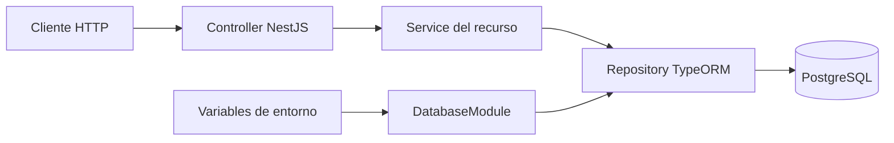

# Arquitectura del backend

Documento basado en la implementación del repositorio al 13 de octubre de 2026.

## 1. Visión general

El backend de TesisPro es un monolito modular construido con NestJS y TypeScript. Expone una API HTTP para gestionar información académica, marketing, leads, proyectos de tesis, conversaciones, negociación y KPIs. Los datos se almacenan en PostgreSQL mediante TypeORM.

Los módulos se ejecutan dentro de un único proceso y comparten una conexión a la base de datos. La organización por dominios facilita separar responsabilidades, pero no corresponde a microservicios.

| Componente | Tecnología y función |
| --- | --- |
| Servidor HTTP | NestJS 12 con adaptador Express |
| Lenguaje | TypeScript, compilado a JavaScript con módulos ESM |
| Persistencia | TypeORM 1.1 y controlador `pg` |
| Base de datos | PostgreSQL |
| Configuración | `@nestjs/config` para la aplicación y `dotenv` para la CLI de migraciones |
| Dependencias | pnpm y `pnpm-lock.yaml` |
| Pruebas | Vitest; Supertest para HTTP |

## 2. Componentes y flujo de solicitudes



Cada recurso sigue la estructura `controller → service → repository`:

- **Controller:** define rutas HTTP, recibe cuerpos y parámetros, y delega al servicio.
- **Service:** realiza las operaciones CRUD y comprueba la existencia del registro antes de consultar, actualizar o eliminar por ID.
- **Repository:** se inyecta con `@InjectRepository` y ejecuta la persistencia sobre una entidad.
- **Entity:** declara columnas, identificadores y relaciones con decoradores de TypeORM.
- **Module del recurso:** registra la entidad con `TypeOrmModule.forFeature`, el controller y el service; exporta el service.

Los módulos de dominio agrupan y exportan sus módulos de recursos. `AppModule` reúne los ocho dominios originales, el módulo administrativo, la configuración global y la conexión a PostgreSQL. El módulo administrativo utiliza consultas parametrizadas mediante `DataSource`/`EntityManager` de TypeORM y transacciones para los flujos que abarcan varios recursos.

## 3. Organización por dominios

| Módulo | Recursos |
| --- | --- |
| Académico | Universidad, facultad, grado académico, programa académico, directiva de tesis, etapa de tesis, necesidad académica |
| Usuarios | Usuario interno, agente IA |
| Marketing | Plataforma, cuenta de red social, campaña, concepto visual, publicación, convenio institucional, recurso gratuito, sesión de landing |
| Leads | Estado de lead, lead, enlace referido, historial de estados, perfil académico, perfil laboral, consentimiento de datos |
| Proyectos | Servicio, proyecto de tesis, necesidad del proyecto, descarga de recurso |
| Conversaciones | Conversación, mensaje, derivación humana |
| Negociación | Propuesta, detalle de propuesta, objeción, objeción del lead, seguimiento, contrato, pago, cliente |
| KPIs | Definición de KPI, medición de KPI |
| Administración | Autenticación, sesiones, gestión de leads, cronogramas, cuotas, abonos y resumen |

Hay 44 entidades registradas en `src/entities/index.ts`. Las relaciones entre entidades conectan los dominios: por ejemplo, una propuesta referencia un lead y puede asociarse con un proyecto y una conversación; una publicación pertenece a una cuenta de red social.

Los recursos de agente IA y KPI representan datos persistidos. Su presencia no implica que existan integraciones con modelos de IA ni un servicio de cálculo automático de indicadores.

## 4. Estructura del repositorio

```text
src/
  main.ts                  # Punto de entrada del servidor
  app.module.ts            # Composición de módulos
  app.controller.ts        # GET /
  app.service.ts           # Respuesta del endpoint raíz
  common/enums/            # Enumeraciones del modelo de datos
  database/                # Conexión NestJS y DataSource de la CLI
  entities/                # Modelo de persistencia y registro de entidades
  migrations/              # Evolución del esquema de PostgreSQL
  modules/                 # Dominios y recursos CRUD
test/                      # Prueba HTTP e2e
scripts/                   # Generadores de entidades, scaffold y migración
impulse_fase1_2.sql         # Script SQL del modelo inicial
```

La compilación utiliza `src` como directorio raíz y produce `dist/main.js`, `dist/entities/`, `dist/database/` y `dist/migrations/`.

## 5. API HTTP

Las rutas de recursos se declaran directamente con nombres como `/universidad`, `/lead` y `/proyecto-tesis`. No hay un prefijo global ni versionado configurados en `main.ts`.

| Operación | Ejemplo | Comportamiento |
| --- | --- | --- |
| Listar | `GET /universidad` | Devuelve los registros mediante `repository.find()` |
| Consultar | `GET /universidad/:id` | Busca por identificador; devuelve 404 si no existe |
| Crear | `POST /universidad` | Crea y guarda una entidad |
| Actualizar | `PATCH /universidad/:id` | Busca el registro, aplica los campos recibidos y guarda |
| Eliminar | `DELETE /universidad/:id` | Comprueba que existe y elimina |

Los controllers CRUD heredados reciben `Partial<Entidad>` y mantienen sus formatos de lectura sin paginación. Las rutas `/admin/*` y `/auth/*` usan DTOs y `ValidationPipe` por controller. Los listados administrativos incorporan filtros, ordenamiento y paginación en PostgreSQL.

Un guard global verifica sesión y rol administrador en las rutas de datos, incluidos los CRUD heredados. `GET /` y el login son públicos. Las escrituras heredadas de lead, historial, estados, usuario, cliente, propuesta, contrato y pago se bloquean para conservar las reglas administrativas. La sesión utiliza cookie HttpOnly y las mutaciones verifican el origen. No se configura Swagger ni CORS abierto; el frontend accede mediante proxy del mismo origen.

`GET /` devuelve `Hello World!`. Sirve para comprobar la respuesta HTTP del servidor, pero no consulta tablas ni constituye una prueba completa del esquema de datos.

## 6. Persistencia y ESM

Las entidades se registran explícitamente y se utiliza `SnakeNamingStrategy` para los nombres derivados. Las columnas y relaciones que requieren nombres específicos los declaran mediante decoradores.

El proyecto conserva `"type": "module"`, resolución `nodenext`, decoradores y `emitDecoratorMetadata`. Los imports locales utilizan la extensión `.js` para que el JavaScript compilado pueda ejecutarse en Node.

Las relaciones singulares con clases importadas se tipan con `Relation<T>` para evitar que los metadatos accedan a clases todavía no inicializadas durante una importación circular:

```ts
import type { Relation } from 'typeorm';

@ManyToOne(() => Universidad, (universidad) => universidad.facultades)
@JoinColumn({ name: 'id_universidad' })
universidad: Relation<Universidad>;
```

`Relation<T>` modifica el tipado de la propiedad, conservando la relación declarada en el decorador. También existen relaciones por nombre con `import type`, como la referencia a facultad en programa académico.

## 7. Configuración y arranque

`main.ts` crea la aplicación a partir de `AppModule` y escucha en `PORT`, con valor predeterminado `3000`. La conexión a PostgreSQL se inicializa antes de que el servidor quede disponible.

| Variable | Función |
| --- | --- |
| `PORT` | Puerto HTTP |
| `DB_HOST` | Host de PostgreSQL |
| `DB_PORT` | Puerto de PostgreSQL |
| `DB_USERNAME` | Usuario de conexión |
| `DB_PASSWORD` | Contraseña de conexión |
| `DB_DATABASE` | Nombre de la base de datos existente |
| `DB_LOGGING` | Activa logs SQL cuando su valor es `true` |
| `DB_RUN_MIGRATIONS` | Ejecuta migraciones al arrancar cuando su valor es `true` |
| `APP_ORIGIN` | Origen exacto del frontend permitido en login y mutaciones; por defecto `http://localhost:4321` |
| `NODE_ENV` | En `production`, la cookie de sesión requiere HTTPS |

La configuración de la aplicación y la CLI está en archivos separados. Sus nombres de base predeterminados difieren: `DatabaseModule` usa `impulse` y el DataSource de la CLI usa `tesispro`. Definir `DB_DATABASE` explícitamente evita esa diferencia. Las credenciales reales deben permanecer en el entorno y no en este documento.

```bash
# Instalar dependencias
pnpm install --frozen-lockfile

# Desarrollo con recompilación automática
pnpm run start:dev

# Ejecutar el código compilado
pnpm run build
pnpm run start:prod
```

PostgreSQL debe estar disponible y la base indicada por `DB_DATABASE` debe existir. Crear una base vacía permite establecer la conexión, pero los endpoints CRUD necesitan las tablas correspondientes.

## 8. Migraciones

La sincronización automática del esquema está desactivada (`synchronize: false`). El esquema se administra mediante migraciones; la migración inicial incluye tipos enumerados, tablas, claves foráneas, índices, triggers y vistas KPI. Los datos de catálogo del SQL original no estaban incluidos en esa migración. La migración administrativa completa los estados de lead faltantes por código sin reemplazar los existentes.

La aplicación busca las migraciones en `dist/migrations/*.js`. La CLI utiliza `dist/database/typeorm.config.js`, que resuelve el directorio de migraciones respecto de su propia ubicación.

```bash
# Compila y consulta el estado de las migraciones
pnpm run migration:show

# Compila y aplica las migraciones pendientes
pnpm run migration:run

# Compila y revierte la última migración aplicada
pnpm run migration:revert
```

Aplicar o revertir migraciones cambia la base de datos. Para una comprobación de arranque sin cambios de esquema, mantener `DB_RUN_MIGRATIONS=false`. La migración inicial no debe aplicarse sin revisar el estado de una base ya poblada con el SQL inicial.

## 9. Verificación y límites actuales

La comprobación mínima del arranque consiste en compilar, cargar las entidades compiladas, iniciar el servidor y solicitar `GET /`. En la verificación realizada durante la corrección se confirmó la conexión a PostgreSQL y una respuesta `200` con `Hello World!`, sin ejecutar migraciones.

El repositorio incluye una prueba unitaria del controller raíz y una prueba e2e de `GET /`. La prueba e2e importa `AppModule` y requiere la conexión configurada a PostgreSQL. No se necesita ejecutar cobertura completa para verificar un cambio de documentación o una corrección acotada del arranque.

El arranque y el endpoint raíz no garantizan que todas las tablas existan ni que todos los flujos CRUD funcionen. El backend conserva los recursos CRUD y añade reglas administrativas de validación, permisos y cobranza. Cada contrato admite un cronograma con cuotas fechadas; los abonos se registran en `pago`, pueden ser parciales y no superan el saldo. Los pagos históricos sin cuota se conservan.

`pnpm run test:admin` verifica migraciones, autenticación, filtros y operaciones financieras por HTTP en un esquema PostgreSQL temporal. `pnpm run admin:create` configura el primer administrador con contraseña oculta. La documentación de endpoints, compatibilidad y operación está en [ADMINISTRACION.md](ADMINISTRACION.md).
